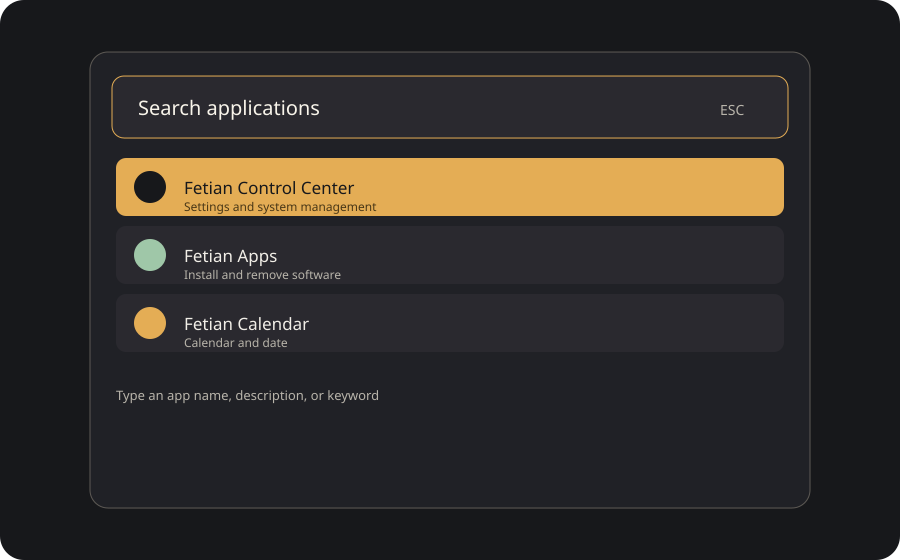

# FetianOS

FetianOS is an independent, Manjaro-compatible Linux operating system for developers and power users. It combines a Sway/Wayland desktop, automatic hardware detection, a unified eye-friendly design system, safe system tools, and live development without rebuilding the ISO.

Authored for [fetian.online](https://fetian.online). Not affiliated with Manjaro or Arch Linux.

## Vision

FetianOS is designed to be automatic, understandable, comfortable, powerful, recoverable, and maintainable. Supported hardware should work without manual driver hunting; system state should be visible; privileged actions should be explicit; and the desktop should remain calm and readable.

## Current status

FetianOS is a developer preview. It currently includes Sway, Waybar, Wofi, Foot, Mako, PipeWire, NetworkManager, Bluetooth, Calamares, Fetian Control Center, hardware reporting, health reporting, Fetian Apps, Fetian Calendar, interactive power controls, eye-care defaults, and a source hot-reload workflow.

Do not use it on critical systems without backups. It is not yet a production-certified distribution.

## Included experience

### Visual preview

These are FetianOS design previews showing the intended Control Center and application-search experience:




The live UI is available through `make dev-desktop`; these previews are kept in the repository so contributors can discuss the visual language without needing to build the ISO first.

- Sway/Wayland desktop with keyboard-first controls
- Warm dark Fetian design across GTK, Sway, Waybar, Wofi, and Foot
- Gammastep night light and reduced-glare defaults
- Waybar controls for apps, settings, power, CPU, RAM, disk, network, audio, battery, and calendar
- Wofi launcher with icons, fuzzy matching, descriptions, and keyboard search
- Fetian Control Center for overview, hardware, appearance, network, software, system, and power
- Fetian Apps commands such as `install chromium`, `uninstall firefox`, and `search browser`
- Fetian Hardware Report and Fetian Health in text and JSON formats
- Signed Manjaro repositories, Linux kernel, firmware, `fwupd`, sensors, and power profiles

## Keyboard controls

| Shortcut | Action |
|---|---|
| `Super + Enter` | Open terminal |
| `Super + D` / `Super + Space` | Search applications |
| `Super + ,` | Open Control Center |
| `Super + Shift + A` | Open Fetian Apps |
| `Super + Shift + N` | Warm night light action |
| `Super + Shift + C` | Reload Sway configuration |
| `Super + Shift + Q` | Close focused window |
| `Print` | Select screenshot |
| `Super + Print` | Full screenshot |

## Waybar controls

Click **APPS** for icon-based application search; right-click it for Fetian Apps. Click **SETTINGS** for Control Center. Click **POWER** to cycle balanced, performance, and power-saver profiles. CPU and RAM open `htop`; disk opens `btop`; network opens NetworkManager; volume opens audio controls; the clock opens Fetian Calendar; right-clicking the clock opens Control Center.

## Hardware support

FetianOS uses Linux kernel drivers, trusted firmware, and standard services instead of random driver installers. The validation laptop is an HP Laptop 15-bs0xx with Intel i5-7200U, Intel HD 620 (`i915`), AMD Radeon R5 M330/Radeon 520 (`radeon`), Intel AC 3168 Wi-Fi (`iwlwifi`), Realtek Ethernet (`r8169`), Intel/Realtek audio, Synaptics touchpad, UVC webcam support, ACPI battery, and HP WMI controls.

The profile includes `linux-firmware`, `hwdata`, `pciutils`, `usbutils`, `fwupd`, `lm_sensors`, `power-profiles-daemon`, and `udisks2`.

```bash
fetian-hardware-report
fetian-hardware-report --json
fetian-health
fetian-health --json
```

## Repository layout

```text
apps/       Control Center, desktop tools, hardware and health commands
docs/       Architecture, product, installation, development, troubleshooting
manifests/  Kernel and AI compatibility metadata
profile/    mkarchiso Sway profile and installed desktop files
scripts/    Build, validation, host inspection, and live development
```

## Build the ISO

The build uses signed Manjaro repositories and does not format disks or change the host bootloader.

```bash
cd /home/fty/fetianOS
make inspect
make setup
make profile-check
sudo make build
make validate
make test
```

ISO files and checksums go to `output/`; temporary build state is in `work/` and is ignored by Git.

## Live development

Daily UI and desktop development does not require an ISO build or reboot:

```bash
make profile-check
make dev
```

For Control Center, Waybar, Wofi, and Sway:

```bash
make dev-desktop
```

The watcher monitors `apps/`, `profile/sway/airootfs/etc/xdg/`, and `profile/sway/airootfs/etc/sway/`. Python/CSS changes restart the source Control Center; Waybar changes restart the development Waybar; Sway changes use `swaymsg reload`; Wofi and Foot changes apply on their next launch. Install `inotify-tools` for immediate events, otherwise one-second polling is used.

```bash
sudo pacman -S inotify-tools
```

Press `Ctrl+C` to stop. The installed system and ISO remain unchanged.

## Fetian Apps

Open with Waybar, Control Center, `Super + Shift + A`, or `fetian-apps`. Type:

```text
install chromium
uninstall firefox
remove vlc
search browser
```

Matching signed repository packages are shown, confirmation is required, and `pkexec` authenticates the transaction. If a package is unavailable, Fetian Apps reports that rather than using an untrusted source.

## Installation safety

Install only from a live ISO and verify the disk in Calamares. On the validation laptop, `/dev/sdb` contains the current system and `/dev/sda` is a separate 465 GB HGST disk. A full `/dev/sda` install would normally use `/dev/sda1` as `/boot/efi`, `/dev/sda2` as `/`, and `/dev/sda` as bootloader target. Formatting erases data; back up first and never select `/dev/sdb` accidentally.

## Security model

Read-only detection needs no privilege. Package, firmware, power, and destructive operations require authentication or confirmation. Sources must be signed. Hardware reports stay local unless the user shares them. Build artifacts, logs, caches, and reports are excluded from Git.

## Validation and contribution

```bash
make profile-check
```

This checks manifests, duplicate packages, required platform packages, and required source files. Use `make validate` for a built ISO. Contributions should use a feature branch, hot reload for testing, profile validation, documentation updates, and a pull request. See [CONTRIBUTING.md](CONTRIBUTING.md) and [docs/development.md](docs/development.md).

## Roadmap

Next: a real `fetian-hardwared` D-Bus service, package descriptions and icons in Fetian Apps, richer audio/display/Bluetooth/network pages, automated hardware diagnostics, signed updates with rollback, snapshots, recovery tooling, supported-hardware certification, accessibility review, and reproducible release builds.

See [docs/product.md](docs/product.md) for the full product charter.

## License

FetianOS project files are MIT licensed. Third-party packages retain their upstream licenses.
