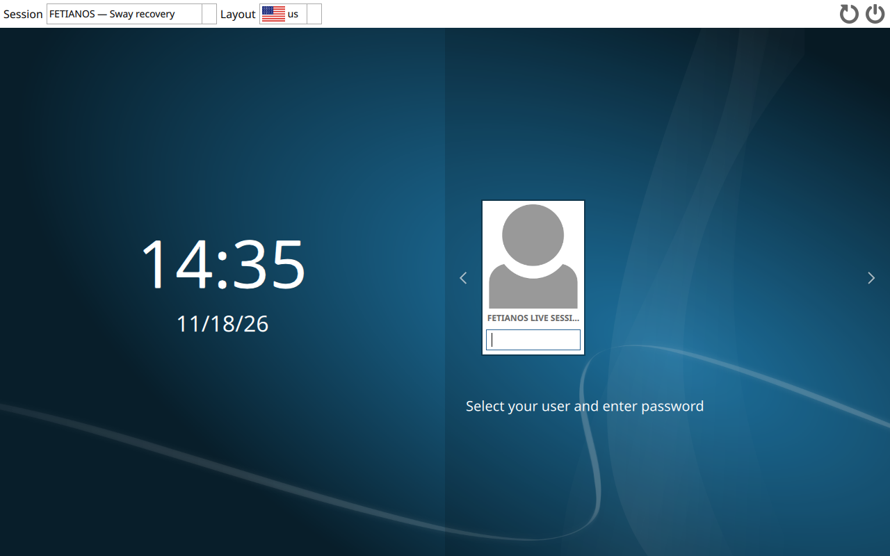

# Actual UEFI live boot evidence — 18 November 2026

[ISO workflow run 44321545719](https://github.com/fetian-debug/FetianOS/actions/runs/44321545719)
built source commit `3563925c68aae66a9607bb51b7f369e8b404eb84` in the disposable
Manjaro container. Static image checks passed, and the generated ISO booted with
OVMF/QEMU/KVM into Linux userspace. The live-account provisioning service emitted
`FETIANOS_LIVE_LOGIN_READY`, and the bounded serial probe passed.

The [original VM evidence JSON](evidence/uefi-3563925.json) identifies the exact
ISO SHA-256, firmware, command, disposable disk and observed checks. Its
graphical-login, installation, hardware and shutdown acceptance flags remain
false. This was a VM boot, not an installation or physical-device test.

The actual QEMU framebuffer shows SDDM with the FetianOS live user and Sway
recovery session. No successful password entry, desktop session, unlock or
application interaction is inferred from that image. The original PPM was
losslessly encoded as PNG; RGB pixel bytes were preserved.

Earlier builds exposed missing boot artifacts and an interactive firstboot
timezone prompt. Kernel discovery, pre-pack validation, the live-only firstboot
condition and the configured console-font package were corrected before this
successful boot. Normal installed-system firstboot behavior is retained.

This run failed afterward when the runner could not read the container-owned
completed image directory. A scoped artifact-ownership handoff was added in
commit `e4b220a9ddc1a1202a1e2fd2fda7a31e997fda7f`, with tests that exclude the
embedded root filesystem and reject symlink escapes before changing ownership.
The subsequent run must complete packaging and publication before its ISO is
offered as a download. The booted image above is not a published release.

Default images exclude experimental FCA. Its independent Rust/Python handoff
and process recovery passed [hosted FCA validation](https://github.com/fetian-debug/FetianOS/actions/runs/44323523164);
see the [FCA engineering report](fca/validation-report.md) for that separate scope.
